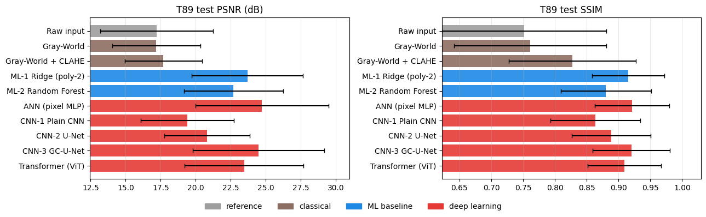

# Given or Learned? Global Colour Context in Learned Underwater Image Enhancement

**Underwater Image Enhancement for Maritime Security (SIH25243)**, Deep Learning Research Project

| Author | Roll No. |
|---|---|
| Raghav | 23CSU255 |
| Shobhit Niraj Anadkat | 23CSU290 |

The NorthCap University, Gurugram, India

---

## Overview

Underwater images lose red light with depth and pick up a blue-green haze, and how strong both effects are changes from photo to photo. This project builds a complete, reproducible pipeline for supervised underwater image enhancement on the **UIEB** benchmark. It asks one question: *how much does a model gain from knowing an image's global colour cast, and can a network learn it unaided?*

Nine methods are compared under a single training protocol: two classical corrections, two ML baselines (Ridge, Random Forest), a pixel-wise ANN, a plain CNN, a U-Net, our **global-context U-Net (GC-U-Net)** and a hybrid **Vision Transformer**.

📄 **Paper:** [`paper/Given_or_Learned_Global_Colour_Context_UIE.docx`](paper/Given_or_Learned_Global_Colour_Context_UIE.docx) · 📘 **Report:** [`paper/UIEB_Project_Report.pdf`](paper/UIEB_Project_Report.pdf) · 📓 **Notebook:** [`notebooks/UIEB_Underwater_Image_Enhancement.ipynb`](notebooks/UIEB_Underwater_Image_Enhancement.ipynb)

## Key results (T89 test set, 256×256)

| Method | Family | PSNR (dB) ↑ | SSIM ↑ | UIQM ↑ | UCIQE ↑ | Params |
|---|---|:-:|:-:|:-:|:-:|--:|
| Raw input | reference | 17.22 | 0.752 | 2.688 | 0.338 | 0 |
| Gray-World + CLAHE | classical | 17.70 | 0.827 | 3.081 | 0.339 | 0 |
| ML-1 Ridge (poly-2) | ML baseline | 23.68 | 0.915 | 3.036 | 0.395 | 759 |
| ML-2 Random Forest | ML baseline | 22.70 | 0.880 | 3.233 | 0.362 | 7.2 M |
| **ANN (pixel MLP)** | deep learning | **24.73** | **0.921** | 3.103 | 0.395 | 11 k |
| CNN-1 Plain CNN | deep learning | 19.40 | 0.864 | 3.166 | 0.340 | 57 k |
| CNN-2 U-Net | deep learning | 20.81 | 0.889 | 3.212 | 0.371 | 1.9 M |
| **CNN-3 GC-U-Net** | deep learning | 24.47 | 0.920 | 3.036 | **0.401** | 2.0 M |
| Transformer (ViT) | deep learning | 23.44 | 0.909 | 3.184 | 0.392 | 1.9 M |

**Findings**
- Giving the U-Net 12 whole-image colour statistics raises test PSNR from **20.81 → 24.47 dB** (+3.67 dB) at matched capacity.
- The Transformer gets no statistics but attends across the whole image. It reaches 23.44 dB and recovers about 72% of that gain.
- The 11 k-parameter ANN (24.73 dB) is statistically tied with the GC-U-Net (p = 0.13).
- The two no-reference metrics (UIQM, UCIQE) rank the methods differently from each other and from PSNR/SSIM.
- **At UIEB's data scale, access to global colour context matters more than network depth or size.**



## Dataset

| What | Link |
|---|---|
| Kaggle copy used by the notebook (`naomirory2/uieb-final`) | https://www.kaggle.com/datasets/naomirory2/uieb-final |
| Official UIEB project page | https://li-chongyi.github.io/proj_benchmark.html |
| UIEB paper (Li et al., IEEE TIP 2020) | https://arxiv.org/abs/1901.05495 |

UIEB has 950 real underwater images: 890 with reference images and 60 challenging images without references. After deduplication and integrity checks we use **712 train / 79 val / 89 test (T89)**, plus the **C60** challenge set. The data is **not** stored in this repo. The notebook downloads it.

## Repository structure

```
uieb-global-colour-context/
├── README.md
├── requirements.txt
├── .gitignore
├── notebooks/
│   └── UIEB_Underwater_Image_Enhancement.ipynb    ← full pipeline (Part 1 ETL + Part 2 models)
├── results/
│   ├── midterm_summary.md                          ← auto-written results summary
│   ├── tables/
│   │   └── test_results_T89.csv                    ← final T89 test metrics
│   └── figures/
│       ├── eda/                                    ← Part 1: data cleaning & EDA
│       │   ├── eda_flagged_duplicates.png
│       │   ├── eda_colour_and_psnr_ssim_diagnostics.png
│       │   ├── eda_clean_pairs_spot_check.png
│       │   └── split_stats_colour_cast.png
│       ├── 02_gc_unet_tuning.png                   ← Part 2: tuning
│       ├── 03_regularization_curves.png            ← Part 2: training curves
│       ├── 03b_cnn_val_curves.png
│       ├── 03c_transformer_curves.png
│       ├── 04_test_metrics.png                     ← Part 2: evaluation
│       ├── 05_visual_comparison_test.png
│       ├── 06_failure_cases.png
│       └── 07_challenge_c60.png
├── paper/
│   ├── Given_or_Learned_Global_Colour_Context_UIE.docx
│   └── UIEB_Project_Report.pdf
└── literature_review/
    └── Literature_Review_UIE.xlsx
```

## How to run

1. Open [`notebooks/UIEB_Underwater_Image_Enhancement.ipynb`](notebooks/UIEB_Underwater_Image_Enhancement.ipynb) on **Kaggle** and set **Accelerator → GPU T4 ×1** and **Internet → ON**.
2. **Run All.**
   - **Part 1 (Steps 0–11):** download, integrity scan, deduplication, EDA, clean dataset, splits. Takes about 2–3 minutes.
   - **Part 2 (Steps M0–M12):** baselines, ANN, CNNs, Transformer, tuning, ablations, evaluation. Set `RUN_MODE = 'full'` for the report numbers (≈ 2 h on a T4) or `'sample'` for a quick run.
3. Outputs are written to `/kaggle/working/midterm/` (CSVs, figures, model weights, `midterm_summary.md`).

Local setup:

```bash
pip install -r requirements.txt
```

## Metrics

- **PSNR / SSIM:** full-reference fidelity, computed on T89
- **UIQM / UCIQE:** no-reference underwater quality, computed on T89 and C60
- **Paired Wilcoxon signed-rank test** and per-image win rate between methods

## Acknowledgements

The UIEB dataset is by Li et al., *An Underwater Image Enhancement Benchmark Dataset and Beyond*, IEEE Transactions on Image Processing, 29, 4376–4389 (2020).
